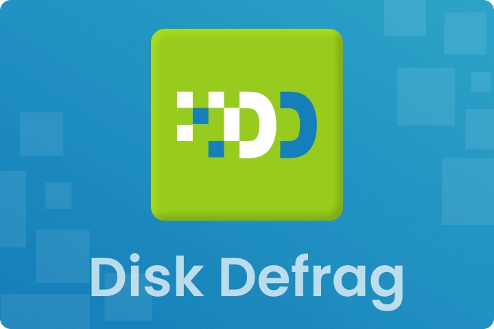
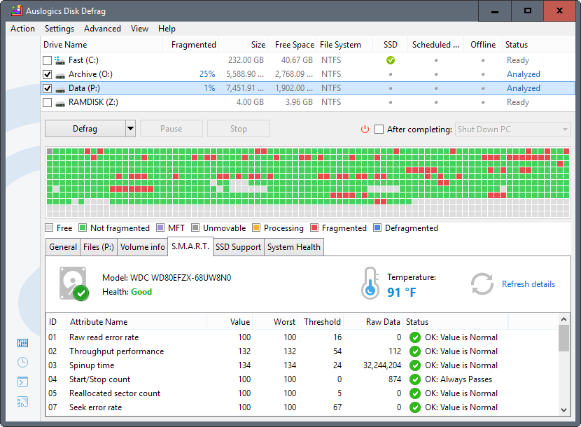

# Auslogics Disk Defrag for Windows HDD Maintenance

Auslogics Software offers Auslogics Disk Defrag for analyzing fragmentation and maintaining traditional hard disk drives.
The auslogics disk defragmenter workflow begins with identifying the target drive and reviewing its analysis results.

Readers comparing auslogics disk defrag pro with auslogics disk defrag ultimate should check each product's current feature list.
Edition names and historical versions should not be treated as interchangeable descriptions of one feature set.

[](https://auslogics-software.github.io/Auslogics-Disk-Defrag/)

This repository documents the Auslogics application and links to a supplied CrystalDiskInfo snapshot for comparison.
The relative source links belong to CrystalDiskInfo and its interface components.
They are not Auslogics source code, defragmentation algorithms, or configuration files for Disk Defrag.

## Overview

File fragmentation describes a file being stored in multiple extents rather than a single contiguous extent.
On a mechanical drive, the effect on access time depends on the layout and the workload.
Defragmentation changes file placement; it does not replace free-space analysis or hardware diagnostics.

| Question | Useful information | What it does not establish |
| --- | --- | --- |
| Is the selected volume fragmented? | A fragmentation analysis | The health of the physical drive |
| Is the storage rotational or solid-state? | Device type and storage configuration | Whether maintenance will improve a workload |
| Is there enough working space? | Available space and allocation layout | That every fragmented file can be relocated |
| Did the operation finish? | Completion status and report | A guaranteed improvement in application speed |
| Is the machine slow for another reason? | Workload observations and diagnostics | That fragmentation is the sole cause |
| Which edition is appropriate? | Current product comparison | That older tutorials describe current behavior |

**Storage identity and health**

Record the drive or volume being examined before interpreting a report.
A drive letter identifies a volume, while hardware information may describe the device beneath it.
Virtual disks, RAID controllers, and USB bridges can complicate that relationship.

For comparison, CrystalDiskInfo's [AtaSmart.cpp](AtaSmart.cpp) and [AtaSmart.h](AtaSmart.h) concern device information and SMART handling.
They do not implement the Auslogics fragmentation scan or prove that a volume needs defragmentation.



**Inspect device information with Windows PowerShell**

The following example uses the Windows Storage module, not an Auslogics API.
It lists physical-disk information exposed by available storage providers.

```powershell
Get-PhysicalDisk |
    Select-Object FriendlyName, MediaType, BusType, HealthStatus |
    Format-Table -AutoSize
```

An unspecified media type is not proof that the disk is an HDD.
Check the actual storage configuration when the result is ambiguous.
See Microsoft's [Get-PhysicalDisk documentation](https://learn.microsoft.com/powershell/module/storage/get-physicaldisk).

The comparison snapshot's [SystemInfoFx.cpp](Priscilla/SystemInfoFx.cpp) obtains system information through WMI.
[OsInfoFx.cpp](Priscilla/OsInfoFx.cpp) contains operating-system information helpers.
These are CrystalDiskInfo support components, not the implementation of the PowerShell cmdlet.

## Description

Auslogics Disk Defrag provides a graphical view of fragmentation and operations for reorganizing HDD file placement.
Use the analysis result to decide whether an operation is relevant to the selected workload.
Inspect the final report instead of assuming that a completed progress bar explains every remaining fragment.

**Interface comparison material**

CrystalDiskInfo's [DHtmlMainDialog.cpp](DHtmlMainDialog.cpp) implements its HTML-based main dialog.
The shared [MainDialogFx.cpp](Priscilla/MainDialogFx.cpp) provides dialog infrastructure.
These files illustrate a different disk utility's interface organization.

### Major features

- Analyze selected drives before deciding on maintenance.
- Review the fragmentation map and available result information.
- Use HDD defragmentation to consolidate fragmented file extents.
- Compare standard and advanced optimization options by edition.
- Plan automatic maintenance around the machine's workload.
- Review results after an operation rather than relying on a fixed schedule alone.

Confirm available options in the [official product description](https://www.auslogics.com/en/software/disk-defrag/).
Advanced placement and offline capabilities should be checked against the specific paid product.

For an independent interface example, [ListCtrlFx.cpp](Priscilla/ListCtrlFx.cpp) implements a list control.
[StaticFx.cpp](Priscilla/StaticFx.cpp) implements a static display control in the same CrystalDiskInfo support library.
Neither file defines the Auslogics disk map or report format.

## Tasks

**Analyze an explicitly selected drive**

Auslogics documents a command-line utility named cdefrag.exe.
The following PowerShell example requests analysis of one drive rather than starting a defragmentation pass.
Enter an existing executable path and a drive designator such as D:.

```powershell
$defragToolPath = Read-Host 'Full path to cdefrag.exe'
$targetDrive = Read-Host 'Drive to analyze, for example D:'
& $defragToolPath '-a' $targetDrive
```

The -a option requests analysis; the example does not select all drives or add an optimization option.
Check executable availability and access requirements for the installed build.
Syntax and status codes are described in the [Auslogics command-line reference](https://www.auslogics.com/en/software/disk-defrag/command-line/).

**Interpret the result**

1. Confirm that the report refers to the intended volume.
2. Review fragmentation together with available space and file activity.
3. Choose an operation appropriate to the device type and edition.
4. Note the completion status and any files left unprocessed.
5. Compare the same workload before and after maintenance if measuring an effect.

The comparison file [UtilityFx.cpp](Priscilla/UtilityFx.cpp) contains general helper code.
It is not a wrapper around cdefrag.exe and does not validate the example command.

**Keep maintenance tasks distinct**

Defragmentation, cleanup, SMART monitoring, and filesystem error checks answer different questions.
Deleting files can free capacity, while defragmenting changes how existing file extents are arranged.
A useful maintenance report identifies which operation actually ran.



## Periodic scheduling

Choose a schedule based on how files change and when the machine can perform maintenance.
A background operation may still compete with applications for disk access.
Review existing Windows and third-party schedules before adding another recurring task.

- Avoid overlapping maintenance jobs on the same storage.
- Allow time for completion when the computer is normally available.
- Revisit the interval if reports repeatedly show little relevant work.
- Record the target volumes and the selected operation.

The supplied [ImageToast.cpp](Priscilla/ImageToast.cpp) concerns notification presentation in CrystalDiskInfo's interface library.
It is not an Auslogics scheduler, background service, or task definition.

## Settings

**HDD and SSD behavior**

Use the reported media type and the vendor's current product guidance when selecting an operation.
Auslogics positions Disk Defrag for HDD maintenance and offers a separate SSD Optimizer product.
Do not treat HDD file consolidation and SSD TRIM as equivalent operations.

Windows also chooses different default optimization operations according to storage type.
Microsoft's [Optimize-Volume reference](https://learn.microsoft.com/powershell/module/storage/optimize-volume) describes that distinction.

**Presentation settings and comparison references**

Keep labels and status information readable when reviewing results.
CrystalDiskInfo's [DarkMode.cpp](Priscilla/DarkMode.cpp) concerns dark-mode integration.
[ButtonFx.cpp](Priscilla/ButtonFx.cpp) and [FontComboBoxFx.cpp](Priscilla/FontComboBoxFx.cpp) implement interface controls.
[ScrollBarFx.cpp](Priscilla/ScrollBarFx.cpp) provides scrollbar behavior.
These files are independent implementation references and cannot configure the Auslogics interface.

## Compatibility

Auslogics Disk Defrag is a Windows application.
Check the supported Windows release, architecture, filesystem, and edition for the exact build being evaluated.
The Linux repositories used as structural references do not imply a Linux edition of Disk Defrag.

In the supplied CrystalDiskInfo snapshot, [CompileOptions.h](CompileOptions.h) declares compilation options.
[DeclareDPIAware.manifest](DeclareDPIAware.manifest) declares Windows compatibility and display-related application metadata.
Neither file establishes Auslogics system requirements or supported storage controllers.

## Building

Auslogics Disk Defrag is distributed as vendor software; its application source is not supplied here.
The CrystalDiskInfo subset includes references to additional headers and resources that are absent from this snapshot.
Do not assume that the subset is a complete buildable checkout.

## Resources

Use the [Disk Defrag support page](https://www.auslogics.com/en/support/product/disk-defrag/) for product-specific explanations.
The [user manual](https://www.auslogics.com/includes/manuals/disk-defrag/disk-defrag-manual.pdf) provides additional application guidance.
Consult the [Ultimate product page](https://www.auslogics.com/en/software/disk-defrag-ultimate/) when comparing advanced features.

## Support

Include the full product version, edition, Windows version, and affected volume when describing an issue.
Record the selected operation, completion status, error message, and relevant report details.
Explain whether the storage is an HDD, SSD, virtual disk, or an array presented through a controller.
Remove personal filenames and identifying details from screenshots shared publicly.

## Related Search Terms

Auslogics Software, Auslogics Disk Defrag, auslogics disk defragmenter, auslogics disk defrag pro, auslogics disk defrag ultimate, windows, hdd, ssd, storage, defragmentation, disk-optimization, disk-maintenance, system-utilities, administration, ntfs
